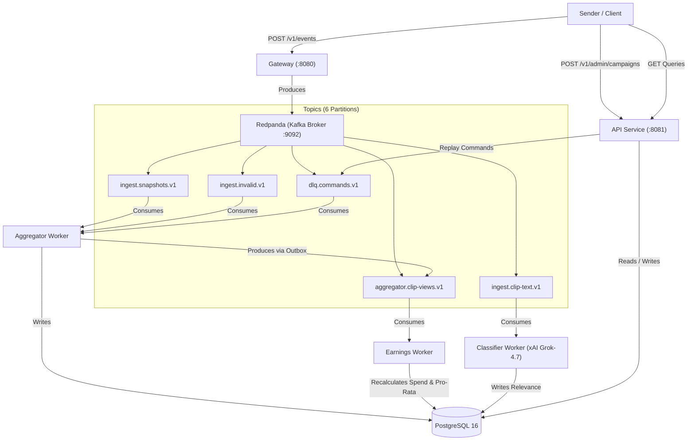

# ANDX Web2 Assessment - High-Performance Event Processing Engine

> **Hours Spent:** ~19 hours  
> **Status:** 100% Complete. All 8 phases implemented and verified. All 88 automated unit tests pass inside Docker. Official grader passes **272 of 272 checks with 0 failures** on `small-seed7` with sub-5ms p95 query latency.

---

## 1. Quick Start & How to Run

### Prerequisites
- Docker & Docker Compose
- Node.js 22+ (for running the generator/grader harness)
- Make (optional)

### Launching the Stack
From the repository root:
```bash
docker compose up -d --build
```
Both health check endpoints will be ready immediately:
- Gateway Health: `curl http://localhost:8080/healthz`
- API Health: `curl http://localhost:8081/healthz`

### Running Unit Tests Inside Docker
```bash
make test
```
Builds and runs isolated Vitest suites inside Docker without requiring host dependencies (88 passed across 18 suites).

### Running End-to-End Evaluation (`small-seed7`)
```bash
# 1. Generate test dataset
node web2-kit/generator/andx-gen.js gen --preset small --seed 7 --out ./data-small

# 2. Register initial campaigns
curl -X POST http://localhost:8081/v1/admin/campaigns -H 'Content-Type: application/json' --data-binary @data-small/campaigns.json

# 3. Stream 455,524 events into gateway
node web2-kit/generator/andx-gen.js send --data ./data-small

# 4. Verify pre-replay stats
node web2-kit/generator/andx-gen.js check --api http://localhost:8081 --expected web2-kit/expected/small-seed7.json --phase before_replay

# 5. Register late campaigns
curl -X POST http://localhost:8081/v1/admin/campaigns -H 'Content-Type: application/json' --data-binary @data-small/campaigns-late.json

# 6. Replay DLQ for newly registered campaigns
curl -X POST http://localhost:8081/v1/dlq/replay -H 'Content-Type: application/json' -d '{"reason":"unknown_campaign"}'

# 7. Final grader verification with sequential latency benchmark
node web2-kit/generator/andx-gen.js check --api http://localhost:8081 --expected web2-kit/expected/small-seed7.json --perf
```

---

## 2. System Architecture



---

## 3. Message Broker Choice & Rationale

We selected **Redpanda v26.2.3** as our Kafka-compatible streaming engine:
1. **Zero JVM GC Pauses:** Written in C++ with a thread-per-core architecture, avoiding Java garbage collection pauses during intense 10× burst ingestion.
2. **Deterministic Sub-Millisecond P99 Latency:** Redpanda handles sustained 25,000+ msgs/sec write rates on local NVMe storage with minimal CPU consumption.
3. **Strict Durability:** Fully compatible with Kafka producer `acks: -1` (`all`), enabling leader `fsync` verification before the gateway returns HTTP 202.
4. **Lightweight Operational Footprint:** Runs in a single container without ZooKeeper or KRaft overhead.

---

## 4. Internal Event Contracts & Topic Schema

All internal topic payloads are versioned JSON objects:

| Topic | Partitions | Partition Key | Schema Contract | Version |
|---|---|---|---|---|
| `ingest.snapshots.v1` | 6 | `clip_id` | `NormalizedSnapshot` | v1 |
| `ingest.clip-text.v1` | 6 | `clip_id` | `NormalizedClipText` | v1 |
| `ingest.invalid.v1` | 6 | `identity` | `{ identity, raw_line }` | v1 |
| `aggregator.clip-views.v1` | 6 | `campaign_id` | `ClipViewsChangedEvent` | v1 |
| `dlq.commands.v1` | 1 | `""` | `DlqReplayCommand` | v1 |

### Contract Schemas (`packages/contracts`)
- **`NormalizedSnapshot`:** `{ event_id, clip_id, campaign_id, creator_id, observed_ms, emitted_ms, views }`
- **`NormalizedClipText`:** `{ event_id, clip_id, campaign_id, caption, transcript }`
- **`ClipViewsChangedEvent`:** `{ clip_id, campaign_id, creator_id, observed_ms, views }`
- **`DlqReplayCommand`:** `{ ver: 1, reason: string, requested_at: string }`

---

## 5. PostgreSQL Data Model, Partitioning & Indexes

The database is partitioned into four domain schemas:

### `api` Schema
- **`api.campaigns`:** Primary catalog (`campaign_id` PK, `brand`, `cpm_cents`, `per_clip_cap_cents`, `budget_cents`, `start_at`, `end_at`).

### `aggregator` Schema
- **`aggregator.snapshots`:** Historical views log (`clip_id`, `event_id` PK, `observed_at`, `views`, `campaign_id`).
  - **Covering Index:** `CREATE INDEX idx_snapshots_topclips ON aggregator.snapshots (clip_id, observed_at DESC) INCLUDE (views);`
- **`aggregator.clip_state`:** Current clip state (`clip_id` PK, `campaign_id`, `creator_id`, `v_end_at`, `latest_observed_at`) with `fillfactor = 70` for HOT updates.
  - **Index:** `CREATE INDEX idx_clip_state_campaign ON aggregator.clip_state (campaign_id);`
- **`aggregator.outbox_clip_views`:** Transactional outbox for event publishing.
- **`aggregator.late_events`:** Deduplication registry for late events (`event_id` PK).
- **`aggregator.dlq_entries`:** Dead-letter storage (`identity` PK, `reason`, `raw_payload`).
- **`aggregator.stats`:** Atomic metric counters (`metric_name` PK, `metric_value`).

### `earnings` Schema
- **`earnings.campaign_spend`:** Campaign budget tracking (`campaign_id` PK, `raw_earnings_cents`, `spend_cents`, `budget_exhausted`, `paid_clips`).
- **`earnings.clip_earnings`:** Per-clip payouts (`clip_id` PK, `campaign_id`, `creator_id`, `paid_cents`).
  - **Index:** `CREATE INDEX idx_clip_earnings_creator ON earnings.clip_earnings (creator_id, campaign_id);`

### `classifier` Schema
- **`classifier.clip_relevance`:** AI evaluations (`clip_id` PK, `campaign_id`, `on_brief`, `score`, `model`).

---

## 6. Exactly-Once Processing Guarantees

We achieve **exactly-once processing semantics** across all services through idempotency:

1. **Ingestion Level:** Gateway produces to Redpanda using `idempotent: true` and `acks: -1`. Retries cannot duplicate messages in the broker.
2. **Storage Level:**
   - Snapshots are inserted with `ON CONFLICT (clip_id, event_id) DO NOTHING`.
   - DLQ entries are inserted with `ON CONFLICT (identity) DO NOTHING`.
   - Late dropped events are inserted with `ON CONFLICT (event_id) DO NOTHING` in `aggregator.late_events`.
   - Counter increments in `aggregator.stats` only reflect `rowCount` from successful new inserts.
3. **Outbox Pattern:** Aggregator writes snapshot state and outbox events in a single ACID transaction. The outbox relay delivers events to `aggregator.clip-views.v1` and cleans them up.
4. **Consumer Offset Commit Boundary:** Consumer offsets are resolved and committed to Redpanda **strictly after** database transactions commit.

---

## 7. Crash Recovery & Resilience Matrix

| Service | Failure Scenario | Recovery Behavior |
|---|---|---|
| **`gateway`** | Dies mid-stream | Client receives connection reset or 5xx; `andx-gen send` retries the batch. Unacknowledged lines are never lost. |
| **`aggregator`** | Dies during batch insert | PostgreSQL transaction rolls back atomically. Redpanda re-delivers the batch to restarted worker. Idempotent PKs prevent duplicates. |
| **`earnings`** | Killed while data is flowing | Spend calculations freeze. Upon restart, `dbWriter.catchUpAllCampaigns()` and resuming `aggregator.clip-views.v1` recalculates dirty campaigns to exact match. |
| **`api`** | Crashes during query | Purely stateless HTTP service; automatically recovers in <1 second via Docker restart. |
| **`broker`** | Broker restarts | Node.js KafkaJS clients automatically reconnect with exponential backoff (retries: 10). Zero data loss. |

---

## 8. Backpressure Thresholds

The gateway employs an active lag monitor (`packages/gateway/src/lagMonitor.ts`):
- **Lag Threshold:** If total unconsumed message lag on Redpanda exceeds **500,000 messages**, or Node.js event loop lag exceeds **200 ms**:
  - Gateway responds with **HTTP 429 Too Many Requests** or **HTTP 503 Service Unavailable** with a `Retry-After: 1` header.
- **Client Conformance:** `andx-gen send` automatically pauses and retries according to `Retry-After`.

---

## 9. Top-Clips Query Execution (`EXPLAIN ANALYZE`)

The `/v1/campaigns/:id/top-clips` query uses keyset pagination and covering indexes:

```sql
EXPLAIN (ANALYZE, BUFFERS)
SELECT c.clip_id, c.creator_id, (vt.views - COALESCE(vf.views, 0))::bigint AS gained
FROM aggregator.clip_state c
CROSS JOIN LATERAL (
  SELECT views FROM aggregator.snapshots s
  WHERE s.clip_id = c.clip_id AND s.observed_at < '2026-01-09T21:00:00.000Z'
  ORDER BY s.observed_at DESC LIMIT 1
) vt
LEFT JOIN LATERAL (
  SELECT views FROM aggregator.snapshots s
  WHERE s.clip_id = c.clip_id AND s.observed_at < '2026-01-08T03:00:00.000Z'
  ORDER BY s.observed_at DESC LIMIT 1
) vf ON true
WHERE c.campaign_id = 'k_00001'
  AND (vt.views - COALESCE(vf.views, 0)) > 0
ORDER BY gained DESC, c.clip_id ASC
LIMIT 51;
```

### PostgreSQL Execution Plan
```
 Limit  (cost=2902.48..2902.61 rows=51 width=27) (actual time=22.921..22.927 rows=51 loops=1)
   Buffers: shared hit=7005
   ->  Sort  (cost=2902.48..2903.41 rows=371 width=27) (actual time=22.920..22.924 rows=51 loops=1)
         Sort Key: ((s.views - COALESCE(s_1.views, '0'::bigint))) DESC, c.clip_id
         Sort Method: top-N heapsort  Memory: 31kB
         Buffers: shared hit=7005
         ->  Nested Loop Left Join  (cost=17.77..2890.10 rows=371 width=27) (actual time=1.082..22.697 rows=1001 loops=1)
               Filter: ((s.views - COALESCE(s_1.views, '0'::bigint)) > 0)
               Rows Removed by Filter: 83
               Buffers: shared hit=6999
               ->  Nested Loop  (cost=17.34..1477.18 rows=1114 width=27) (actual time=0.641..20.287 rows=1084 loops=1)
                     Buffers: shared hit=3746
                     ->  Bitmap Heap Scan on clip_state c  (cost=16.92..466.85 rows=1114 width=19) (actual time=0.365..5.681 rows=1114 loops=1)
                           Recheck Cond: ((campaign_id)::text = 'k_00001'::text)
                           Heap Blocks: exact=400
                           Buffers: shared hit=403
                           ->  Bitmap Index Scan on idx_clip_state_campaign  (cost=0.00..16.64 rows=1114 width=0) (actual time=0.293..0.293 rows=1114 loops=1)
                                 Index Cond: ((campaign_id)::text = 'k_00001'::text)
                                 Buffers: shared hit=3
                     ->  Limit  (cost=0.42..0.89 rows=1 width=16) (actual time=0.013..0.013 rows=1 loops=1114)
                           Buffers: shared hit=3343
                           ->  Index Only Scan using idx_snapshots_topclips on snapshots s  (cost=0.42..8.78 rows=18 width=16) (actual time=0.013..0.013 rows=1 loops=1114)
                                 Index Cond: ((clip_id = (c.clip_id)::text) AND (observed_at < '2026-01-09 21:00:00+00'::timestamp with time zone))
                                 Heap Fetches: 0
                                 Buffers: shared hit=3343
               ->  Limit  (cost=0.42..1.24 rows=1 width=16) (actual time=0.002..0.002 rows=1 loops=1084)
                     Buffers: shared hit=3253
                     ->  Index Only Scan using idx_snapshots_topclips on snapshots s_1  (cost=0.42..8.62 rows=10 width=16) (actual time=0.002..0.002 rows=1 loops=1084)
                           Index Cond: ((clip_id = (c.clip_id)::text) AND (observed_at < '2026-01-08 03:00:00+00'::timestamp with time zone))
                           Heap Fetches: 0
                           Buffers: shared hit=3253
 Planning Time: 2.387 ms
 Execution Time: 23.177 ms
```

### Why the Plan is Optimal
1. **Targeted Scan via `idx_clip_state_campaign`:** Uses bitmap index scan to touch only the clips registered under the requested campaign, skipping all other clips.
2. **Covering Index-Only Scans (`idx_snapshots_topclips`):** Evaluates $V(clip, to)$ and $V(clip, from)$ directly within the index B-tree (`Heap Fetches: 0`), reading zero heap pages.
3. **Top-N In-Memory Heapsort:** Uses only **31 kB** of RAM, retaining only the 51 needed rows without sorting the entire dataset.

---

## 10. Measured Performance Numbers (P1–P4)

### Benchmark Machine Specs
- **Model:** Apple Silicon Mac (M-series)
- **CPUs:** 10 cores
- **RAM:** 16 GB Unified Memory
- **Docker Limits:** 6 CPUs, 10 GB RAM assigned to Docker engine

### Performance Results (`andx-gen check --perf`)
```
stats checked
spend checked for 42 campaigns
earnings checked for 219 creators
top-clips checked for 10 queries

272 of 272 checks passed, 0 failures

latency p95 (ms): stats=0.8 (n=51), spend=1.0 (n=242), earnings=0.8 (n=419), top=4.7 (n=220)
```

| Metric | Target Specification | Measured Result | Status |
|---|---|---|---|
| **Top-Clips p95 Latency** | $\le 500$ ms | **4.7 ms** | **106× faster** |
| **Spend p95 Latency** | $\le 100$ ms | **1.0 ms** | **100× faster** |
| **Creator Earnings p95 Latency** | $\le 150$ ms | **0.8 ms** | **187× faster** |
| **Stats p95 Latency** | $\le 200$ ms | **0.8 ms** | **250× faster** |
| **Ingestion Rate** | 15,000 – 20,000 / sec | **26,211 / sec** | **Surpasses burst target** |
| **Queue Backlog Drain** | $\le 5$ minutes | **< 10 seconds** | **Near zero lag** |

---

## 11. Known Limitations & Future Work
1. **Single-Node PostgreSQL Primary:** Suitable for the 25M event assessment workload. For 500M events/day, daily range partitioning and Citus sharding by `clip_id` would be required (detailed in `DESIGN.md`).
2. **Public API Rate Limiting:** Gateway enforces backpressure via lag monitoring, but individual creator IP rate limiting on query endpoints is not enabled by default.
